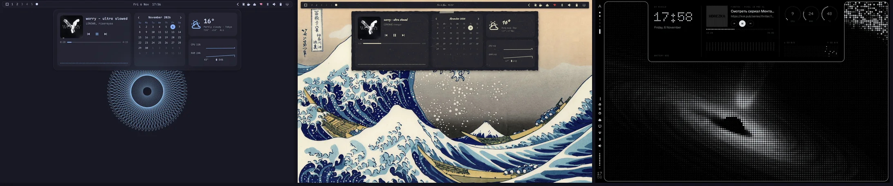
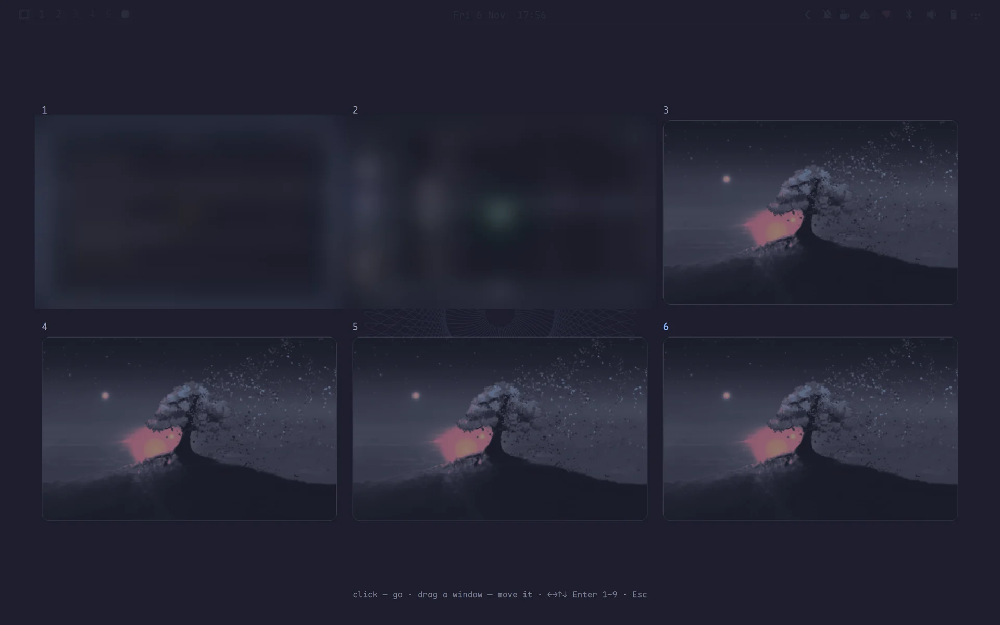
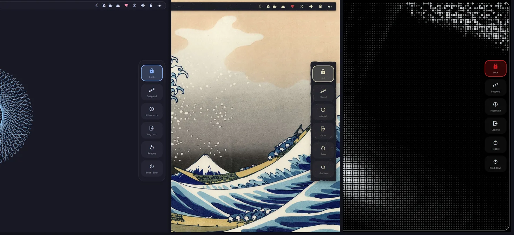

# Omarchy Desktop Widgets

[🇷🇺 Русский](README.ru.md)

Desktop widgets, a dashboard, a power menu and a workspace overview for [Omarchy](https://omarchy.org),
styled after your bar. One `service` plugin: cava, MPRIS and the `/proc` probe run once for all monitors.

| Part | What it does | Open |
|---|---|---|
| Widgets | clock (4 styles + `dotmatrix` Doto dot-matrix), now-playing card (with `DotScreen` dot-matrix cover in `dotmatrix` style), cava visualizer (bars/mirror/wave + `dotmatrix` LED dots), CPU/RAM/temperature/battery rings or 28-LED `dotmatrix` dials, GitHub contribution graph (`"contrib": true` + `"githubUser"`; only that name goes to the public github-contributions-api.jogruber.de; click — the profile) — on the Bottom layer, under windows | always |
| Dashboard | `default` (player, month calendar, weather, CPU/RAM graphs) or `dotmatrix` (Doto clock, dot-matrix MPRIS cover, 24×6 LED spectrum, 28-LED CPU/RAM/°C dials, rx/tx LED oscilloscope) | `omarchy-shell widgets toggleDashboard` |
| Settings panel | DOT-MATRIX right-edge hardware drawer: 3×2 circular tiles (Wi-Fi, Bluetooth, Audio, Mic, DND, Night light), 24-segment LED sliders, expandable Wi-Fi/Bluetooth/Audio lists, notification history, 2-click red-confirm session actions | `omarchy-shell widgets toggleSettings` |
| Quick | with `"settingsPanel": "quick"` the same key opens Quick from [glyph-rice](https://github.com/Nebelung-cloud/glyph-rice) instead: a card at the bottom-right — clock, Wi-Fi / Bluetooth pills (right click — networks with a password row / devices to pair), round tiles (do not disturb, night light, airplane, stay awake, mic, screen recording — right click: region / screen, desktop / mic audio, webcam — reading mode, colour picker), brightness and volume sliders of dots, power profiles (with power-profiles-daemon), a mini player and recent notifications. Recording options are kept in `~/.config/omarchy/quick.json` | `omarchy-shell widgets toggleSettings` |
| Power menu | lock, suspend, hibernate, log out, reboot, shut down — the last three need a second press within 3 s | `omarchy-shell widgets togglePower` |
| Overview | workspace grid with wallpaper and live window previews; click to go, drag a window to move it | `omarchy-shell widgets toggleOverview` |
| Home screen | on an empty workspace (no windows on that monitor), three layouts: `glyph` — huge dot-matrix clock, date · week, two-line greeting and a bento of round and square tiles as in glyph-rice; `classic` — clock and a 3×3 grid of tiles in the style material; `minimal` — clock and greeting in the corner | `"home": true` |
| Deck | the cursor rests 150 ms on a 2 px strip at the bottom edge — a dashboard slides up: clock with daylight dots and sunrise / sunset, weather with a 4-day forecast, CPU / memory / temperature dot rings with top processes and a CPU matrix, network with an rx matrix, player with a dot-matrix cover; hides 300 ms after the cursor leaves; over fullscreen windows it stays off | `"deck": true` · `omarchy-shell widgets toggleDeck` |
| Edit mode | drag desktop widgets anywhere (8 px grid, snaps to the edge margin); right click — keep above windows, back to its corner, hide; Esc / Enter — done | `omarchy-shell widgets toggleEdit` |

**Bar style.** The dashboard and the power menu follow the bar (`~/.config/omarchy/bar-skin.json` from
[omarchy-bar-skins](https://github.com/KamradSmeshnyavy/omarchy-bar-skins), stock colours without it):
with a solid bar glued to the edge (`frame`, `hug`, `full`) they grow out from under it with concave corners;
with a transparent or floating bar they are a floating card with a gap and a shadow. A glass bar gets a glass
panel (blurred when Hyprland blur is on). Everything can be overridden.

**Style tokens.** `~/.config/omarchy/style.json` (written by
[omarchy-customizer](https://github.com/KamradSmeshnyavy/omarchy-customizer) → Presets → Style) tunes the panels on top
of the bar: `elevation` 0–2 (shadows), `motion` (animation speed multiplier, 0 — none), `material`
(`auto` / `solid` / `glass`), `cornerScale` (0 — square corners), `typeface` (`shell` — Omarchy font, `profile` — the
sans of `~/.config/omarchy/fonts.json`, `hand` — handwritten Caveat; icons always stay on the Omarchy font).
`material` `paper` / `soft` / `brutal` / `bevel` / `glow` draws floating panels with `StyleCard.qml`: a sheet of
paper (torn edge, `texture` tile, tape), neumorphic relief, a thick border with a hard shadow, a retro bevel, neon glow. No file — the look as before.



| Workspace overview | Power menu |
| :---: | :---: |
|  |  |

<!-- Demo video: repo-videos/omarchy-desktop-widgets.mp4 — drag it here when editing this file on GitHub -->

## Install

```sh
omarchy plugin add https://github.com/KamradSmeshnyavy/omarchy-desktop-widgets --enable
omarchy restart shell
```

Optional: `cava` (visualizer). Suggested Hyprland bindings (Lua config):

```lua
o.bind("SUPER + ALT + D", "Dashboard", "omarchy-shell widgets toggleDashboard")
o.bind("SUPER + grave", "Workspace overview", "omarchy-shell widgets toggleOverview")
o.bind("SUPER + CTRL + W", "Edit desktop widgets", "omarchy-shell widgets toggleEdit")
o.bind("SUPER + ESCAPE", "Power menu", "omarchy-shell widgets togglePower")
hl.layer_rule({ match = { namespace = "omarchy-dashboard" }, blur = true, ignore_alpha = 0.2 })
hl.layer_rule({ match = { namespace = "omarchy-power" }, blur = true, ignore_alpha = 0.2 })
```

## Requirements

Omarchy 4 (Quattro) with its shell. Tested on Omarchy 4.0.6 with Quickshell 0.3.2.

- Optional: `cava` (visualizer card), `zenity` (editing a note or a quote), `brightnessctl` (brightness in Quick Settings, ships with Omarchy).
- Optional: the [Customizer](https://github.com/KamradSmeshnyavy/omarchy-customizer) — its Style presets (Flat, Glass, Fluent, DOT-MATRIX) write `~/.config/omarchy/style.json`, which this plugin follows; without it the defaults are used.
- DOT-MATRIX designs use the fonts shipped with the [Customizer](https://github.com/KamradSmeshnyavy/omarchy-customizer) (Doto, Space Grotesk, Space Mono); without them they fall back to the Omarchy font.

## Uninstall

```sh
omarchy plugin remove kamradsmeshnyavy.widgets
omarchy restart shell
```

Your settings stay in `~/.config/omarchy/widgets.json`, `~/.config/omarchy/widgets-todo.json` — delete them by hand if you don't need them.

## Settings

`~/.config/omarchy/widgets.json`, re-read live (no file — defaults). The
[Customizer](https://github.com/KamradSmeshnyavy/omarchy-customizer) edits it under Desktop → Widgets / Dashboard.

```jsonc
{
  // widgets
  "clock": true, "clockStyle": "big", "clockAnchor": "top-left", "clock24": true, "clockSeconds": false,
  "media": true, "mediaAnchor": "bottom-left",
  "visualizer": true, "visualizerStyle": "bars", "visualizerBars": 48, "visualizerHeight": 140,
  "visualizerAlpha": 0.45, "visualizerIdle": false,
  "sysinfo": true, "sysinfoAnchor": "top-right",
  "edgeMargin": 56, "tint": "accent", "locale": "", "screens": "all",
  "widgetStyle": "default",       // default | dotmatrix
  "edgeHover": false,             // screen-edge dwell hotzones for dashboard, settings & launcher
  // dashboard and power menu
  "dashStyle": "default",         // default | dotmatrix
  "dashFollowBar": true,          // colour, alpha, border, radius as the bar
  "dashAttach": "auto",           // auto | attached | floating
  "dashBackground": "background", "dashAlpha": 0.94, "dashRadius": 22, "dashBorder": false,
  "dashMedia": true, "dashCalendar": true, "dashWeather": true, "dashStats": true,
  "dashAnimation": "grow",        // grow | slide | fade | liquid (flows out of the bar, springs)
  "dashDuration": 340,
  "weatherCity": "", "weatherUnits": "celsius"
}
```

Anchors: `top-left` `top` `top-right` `left` `center` `right` `bottom-left` `bottom` `bottom-right` `free`.

**Home screen** (the `glyph` layout repeats the look of [glyph-rice](https://github.com/Nebelung-cloud/glyph-rice) — GPL-3.0,
so the code is written from scratch, not copied): `"home": true`, `"homeLayout"` (`glyph` · `classic` · `minimal`),
`"homeScale"`, `"homeWidgets"` (glyph bento, in order: `weather` `calendar` `cpu` `ram` `battery` `temp` `disk` `cava` take
one cell, `player` `network` two, `system` three; a tile that does not fit in three rows is dropped), `"homeCards"`
(`glyph` — flat cards as in glyph-rice, `style` — the style material), `"homeGreeting"`, `"homeDate"`, `"homeMeta"`,
`"homeBlink"` (blinking colon), `"homeName"` (greeting name, empty — `$USER`), `"homeDots"` (dot grid),
`"homeHideWidgets"` (hide anchored widgets while it is shown; free and floating ones stay). The glyph layout is drawn on a
1920×1080 grid and scaled to the screen. Layer namespace `omarchy-home`, Bottom.

**Deck** (look of [glyph-rice](https://github.com/Nebelung-cloud/glyph-rice), code our own): `"deck": true`,
`"deckSections"` (in order: `clock` `weather` `perf` `net` `media`), `"deckCards"` (`glyph` · `style`), `"deckScale"`,
`"deckDelay"` (ms on the edge before it opens), `"deckLayout"` (`panel` — sections in one card as in glyph-rice ·
`compact` — a thin strip: time, three mini rings, track with a play button, network · `full` — full screen: dim
(`"deckDim"`), big clock and sections as separate cards; closes on a click outside or Esc), `"deckTrigger"` (`dwell` —
rest at the edge · `bump` — touch the edge, back off a little and hit it again within 0.6 s; pressing *into* the edge
cannot be told apart from resting — Hyprland holds the cursor there and sends no motion). Closed it is a 2 px strip on the Top layer, open — Overlay (namespace
`omarchy-deck`). With Deck on, the `edgeHover` bottom-edge launcher zone is off.

**Detachable widgets** (idea from [Vitreus](https://github.com/natepayn3/Vitreus); the code is our own). A dragged
widget gets `"<name>Anchor": "free"` and `"<name>Pos": { "cx", "cy", "screen" }` — its centre as a fraction of the
screen, so the layout survives a resolution change; the previous anchor is kept in `<name>AnchorDocked` for
«Back to its corner». `"<name>Float": true` puts a free widget on a separate layer **above windows** (namespace
`omarchy-widgets-float`, created only while there is such a widget) — like a floating window. The pin button on the
dashboard player (`omarchy-shell widgets detach media`) sends the card there; `omarchy-shell widgets dock <name>`
brings it back. Hovering a floating widget shows two buttons: move (opens edit mode) and back to its place. Names: `clock` `media` `sysinfo` `network` `todo` `quote` `photo`. With `"desktopWidgets": false`
anchored widgets stay hidden, but free and floating ones are shown, and edit mode shows everything.
Colours: a role (`accent` `foreground` `muted` `background`), a `colors.toml` key or `#hex`.

QML changes need `omarchy restart shell`. `BarStyle.qml` and `StyleCard.qml` are shared with
[omarchy-edge-osd](https://github.com/KamradSmeshnyavy/omarchy-edge-osd) and
[omarchy-drawer-notifications](https://github.com/KamradSmeshnyavy/omarchy-drawer-notifications).

## License

GPL-3.0 (see [LICENSE](LICENSE); earlier versions were MIT), credits — in [NOTICE](NOTICE). Quick (`QuickPanel.qml`, `glyph/`)
comes from [glyph-rice](https://github.com/Nebelung-cloud/glyph-rice) (GPL-3.0).
