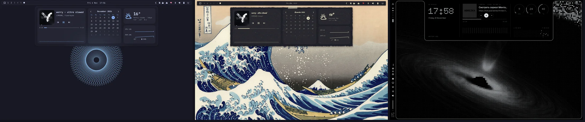
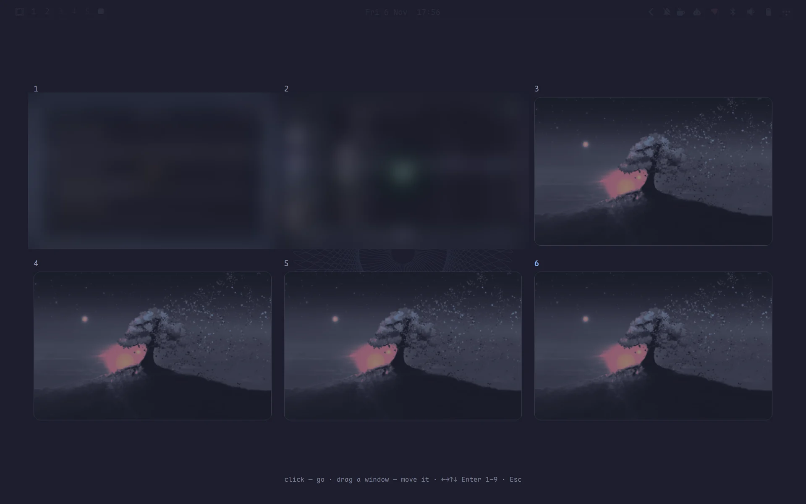
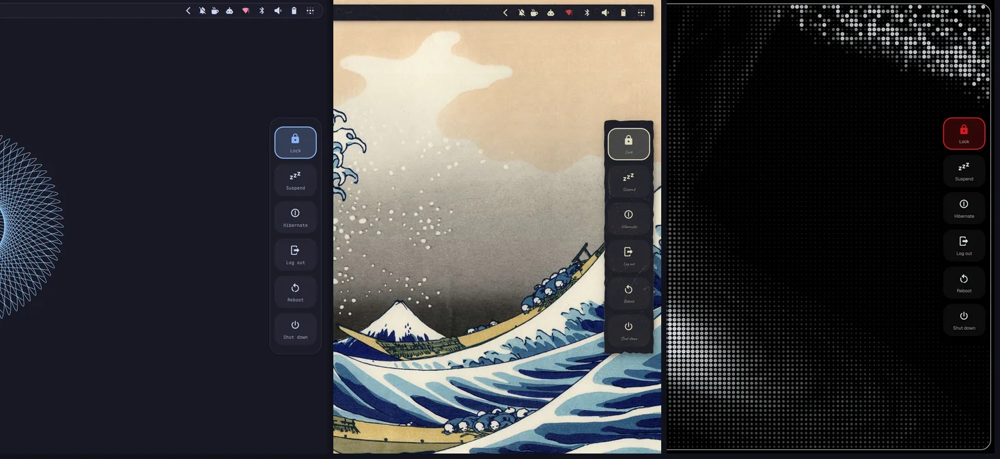

# Omarchy Desktop Widgets

[🇷🇺 Русский](README.ru.md)

Desktop widgets, a dashboard, a power menu and a workspace overview for [Omarchy](https://omarchy.org),
styled after your bar. One `service` plugin: cava, MPRIS and the `/proc` probe run once for all monitors.

| Part | What it does | Open |
|---|---|---|
| Widgets | clock (5 styles: … `vitreus` — glass tube digits, hours over minutes with a bar, `clockVitreusLayout` rule / pipe / digital; + `dotmatrix` Doto dot-matrix), now-playing card (with `DotScreen` dot-matrix cover in `dotmatrix` style), cava visualizer (bars/mirror/wave + `dotmatrix` LED dots), CPU/RAM/temperature/battery rings or 28-LED `dotmatrix` dials (`sysinfoStyle: "vitreus"` — a Vitreus monitor card: host and uptime, three rings CPU / memory / GPU or temperature, a mirrored 120-bar network graph), GitHub contribution graph (`"contrib": true` + `"githubUser"`; only that name goes to the public github-contributions-api.jogruber.de; click — the profile) — on the Bottom layer, under windows | always |
| Dashboard | `default` (player, month calendar, weather, CPU/RAM graphs) or `dotmatrix` (Doto clock, dot-matrix MPRIS cover, 24×6 LED spectrum, 28-LED CPU/RAM/°C dials, rx/tx LED oscilloscope) | `omarchy-shell widgets toggleDashboard` |
| Settings panel | DOT-MATRIX right-edge hardware drawer: 3×2 circular tiles (Wi-Fi, Bluetooth, Audio, Mic, DND, Night light), 24-segment LED sliders, expandable Wi-Fi/Bluetooth/Audio lists, notification history, 2-click red-confirm session actions | `omarchy-shell widgets toggleSettings` |
| Quick | with `"settingsPanel": "quick"` the same key opens Quick from [glyph-rice](https://github.com/Nebelung-cloud/glyph-rice) instead: a card at the bottom-right — clock, Wi-Fi / Bluetooth pills (right click — networks with a password row / devices to pair), round tiles (do not disturb, night light, airplane, stay awake, mic, screen recording — right click: region / screen, desktop / mic audio, webcam — reading mode, colour picker), brightness and volume sliders of dots, power profiles (with power-profiles-daemon), a mini player and recent notifications (replay; clear all — a second press within 3 s, deletes the history for good). Recording options are kept in `~/.config/omarchy/quick.json` | `omarchy-shell widgets toggleSettings` |
| Shot | screenshot from [glyph-rice](https://github.com/Nebelung-cloud/glyph-rice): the screen freezes and dims, a 1 px white frame with dots at the corners and a size in Doto, a dotted loupe with the pixel colour; modes region / window (Space) / screen / record (Tab), timer 3 / 13 s (T). The shot is saved to `$OMARCHY_SCREENSHOT_DIR` or `~/Pictures/Screenshots` and copied; a card slides in at the corner — click it to edit: pen, arrow, rect, pixelate, text, 4 inks, 3 sizes, Ctrl+Z, Enter saves and copies. Record goes through the stock `omarchy-capture-screenrecording` with the picked area (audio and webcam from Quick) | `omarchy-shell widgets shot` · Print |
| Panels out of the bar | with the `liquid` style (Vitreus presets) the dashboard (`"dashAnimation": "liquid"`), the settings panel and the power menu grow out of their own bar button — clock, audio / network, power (the bar writes `$XDG_RUNTIME_DIR/omarchy-bar-geom.json`, `BarGeom.qml` reads it) — at any edge. A bar that runs the whole edge (full, frame) takes them flush, as one piece: glass bodies are joined by a neck along the whole side with concave curves (`DrawerGeom.qml`), and a panel that ends near the frame's edge sticks to it too ("wings"); plastic bases (Retro, Doodle, …) drop the outline on the joined sides and draw inked concave corners (`MergeFillet.qml`). A floating pill keeps a gap and a narrow drop-like neck . **Moving panels.** The dashboard, the settings panel and the power menu come off the bar by their top strip or the Retro base's red tab and move around the desktop (`DrawerPull.qml`, `PullGrip.qml`): the neck stretches and snaps, a panel dropped near its spot sticks back, and within 32 px of a frame / full-edge bar edge it sits flush and merges with it. The spot is remembered (`~/.config/omarchy/panel-places.json`), so the panel opens there next time; double-click a handle to send it back to the bar. **Vitreus dashboard** (`"dashStyle": "vitreus"`, `DashGlass.qml`) — everything at a glance, surfacing through the glass: two tall flask sliders (volume, brightness), the clock in an accent gradient with a day ruler beside reminders (`omarchy-reminder`), recent notifications with Clear and do-not-disturb, a battery gauge with the power button, a user card (avatar — `"dashAvatar"`, set in Customizer → Dashboard, otherwise `~/.face`, otherwise the name's initial; host, distro, kernel, uptime), CPU / memory / GPU rings with the network, the weather with details and a 7-day forecast, and the player with its cover in a ring of visualizer bars and a wavy progress line. The tiles rise one after another and the screen dims a little. **surface** (`"dashStyle": "surface"`, `DashSurface.qml`, after [surface-dots](https://github.com/snes19xx/surface-dots) by snes19xx — its README allows reuse with credit, own code): the two-column Hub of its taskbar mode, 520 px under the clock pill (above it with a bottom bar): avatar and name with system monitor, Customizer, screenshot and power buttons; the player across the whole width on its blurred cover with a long wavy progress line; a big calendar with the weather next to a column of Wi-Fi / Bluetooth / power profile / notification buttons and two tall brightness and volume sliders; the next reminders (`omarchy reminder`); notifications with Clear. Its compact Hub is the Super+M panel — `"settingsPanel": "surface"` (`SurfaceHub.qml`, chosen by `auto` for the surface rice): a 320 px column with avatar, uptime, screenshot / recording / Customizer / power, eight toggles (Wi-Fi, Bluetooth, power profile, notifications, night light, microphone, stay awake, reading mode), brightness, volume and microphone sliders, inline Wi-Fi / Bluetooth / sound output lists (right click on a tile or i / t / a), player, calendar and notifications; keys d / l switch the dark / light surface theme, n folds the notifications, s opens the Customizer. Shared state — `SurfState.qml`, the calendar card — `SurfCalendar.qml`. Its power menu is `"powerStyle": "cassini"` (`PowerCassini.qml`, chosen by `auto` for the surface rice): a serif `@user` / `up 2 hours` card next to a random Cassini photo of Saturn (NASA / JPL-Caltech / Space Science Institute, public domain, `surface/cassini`), the chosen line as a green bar (red for Reboot / Shutdown), then a No / Yes confirmation; arrows, Enter, Esc. **Bruteon** (`"dashStyle": "bruteon"`, `DashBrute.qml`, after the neo-brutalism rice [Bruteon](https://github.com/Darkkal44/Bruteon) — look from its screenshot, own code): an 820 px board of cream cards with a thick dark outline and a hard shadow — profile and a column of apps, the clock with the date, weather with a quote of the time of day, volume and brightness sliders, «System Specs» tiles, the player with a pastel wave of cava dots, CPU / RAM / Disk bars and a row of pastel link tiles. Its «Tasks» button opens `TasksBrute.qml` (`omarchy-shell widgets toggleTasks`): a panel over the windows under the bar with the tasks of the Todo widget (add, tick, right click — remove) and a working Pomodoro (focus 25 / 50, break 5, long 15, a notification at the end) or stopwatch. Its desktop: `"clockStyle": "bruteon"` — an analog dial with an outline and a hard shadow next to «Good morning, user», a big time with a lavender AM / PM tag and the date; `"mediaStyle": "bruteon"` — the cover in an outlined tile, title, artist, a wave of cava dots, times and back / pause (salmon) / next tiles, shown without a player too; the **weather** widget (`"weather": true`, `WeatherWidget.qml`, city — `weatherCity`) — icon and big temperature, «📍 city», the description and humidity / wind chips. All of them take the theme colours, so the dark bruteon theme works too. **Player of the rice** (`PlayerHost.qml`, Super+Alt+M → `omarchy-shell widgets togglePlayer`): a panel on the right at 39 % of the screen height with the MPRIS player (the playing one, otherwise the first with a track), in the look of the rice — `players/Player<Look>.qml`; so far the Unit-3 one (`players/PlayerUnit3.qml`, ported from Unit-3, MIT: the cover with scanlines, title and artist, tags, ◀ PLAY ▶, a seek line, corner marks). **NieR volume bar** (`NierVolume.qml`, the Unit-3 rice or `"nierVolume": true`): 30 segments in a 40 × 420 frame at the left edge, after its VolumeBar — slides out when the pointer touches the edge (a 3 px strip) and on every volume change; click / drag sets, wheel ±8 %. **Unit-3** — `"settingsPanel": "unit3"` (`NierControl.qml`, ported from the NieR control center of [Unit-3](https://github.com/samyns/Unit-3), MIT; chosen by `auto` for the Unit-3 rice): Super+M opens a cross of beige NieR cards over a dimmed screen — Connexion (Wi-Fi with an inline password prompt, Bluetooth with pairing and scan), Audio (output, volume), Quickshare (send / receive files to a phone over HTTP with a QR code, `unit3/qshare.py`, needs `python-qrcode`; the tunnel needs `cloudflared`) and Notifications (the Omarchy history and do-not-disturb; dismissing only hides entries there — `~/.local/state/omarchy/unit3-dismissed.json`, the history files stay). WASD / arrows move, Enter acts, Esc goes back; the cross slides to bring the open card to the centre. The bar sections (`openSettingsSection wifi | bt | audio`) open their card straight away. The Cozytile power menu is `"powerStyle": "cozytile"` (`PowerCozy.qml`, after its rofi menu — look only, own code; chosen by `auto` for the Cozytile rice): an 800 px card on the current wallpaper with « Power» and the uptime, five big icons (lock, suspend, log out, reboot, shut down), the chosen one in the selection colour of the theme; log out, reboot and shut down ask «Are you sure?». **Rumda** (`"dashStyle": "rumda"`, `DashRumda.qml`, after hexonide/rumda — look only): a dense card of blocks — an avatar in a double ring with a column of power buttons, «Hello..» and the user name with app and player buttons, a brightness column and the GitHub contributions graph. **Pencils** (`"dashStyle": "pencils"`, `DashVitreus.qml`): two pencil sliders on the left (volume, brightness) and tiles — clock and date, weather, the player (two cells), controls (Wi-Fi, Bluetooth, mic, night light), system graphs, a mirrored network graph, host with uptime and a battery gauge. The tiles rise one after another as if out of water, a wave runs along the edge by the bar while they do, and the screen dims a little. **yami widgets**: `"clockStyle": "yami"` — a big pixel time in Tiny5 with a hard shadow and the colon in the accent, the date and a 16-step day ruler under it; `"sysinfoStyle": "yami"` — three cards (cpu, memory, temperature) with accent bar graphs (`YamiSys.qml`); `"mediaStyle": "yami"` — a wide card «♫ silence — nothing playing» or the track, visualizer bars and the progress line in the accent, shown without a player too; the **calendar** widget (`"calendar": true`, `CalWidget.qml`) — the month from Monday, today in the accent, the wheel flips months; the style material `pixel` (`StyleCard`) — a flat graphite panel with a one-pixel border and a 3 px hard shadow. **Base decorations** (`BaseDecor.qml`) on these panels follow the Vitreus theme base: Retro — red tab, grip slots and a screw; Cyber — glowing corner brackets, a ruler of ticks and a blinking terminal readout; Paper — two strips of washi tape on the top corners; UwU — cat ears, whiskers, twinkling stars and bobbing hearts; Proxy — a slanted plate with a health bar, a data pill and a hazard rail; Doodle — a second hand-drawn outline. Sides merged with the bar or frame get none. Desktop widget cards do the same (`"edgeMerge": true`, default): a card anchored at a bar / frame edge, or dropped within 32 px of it, sits flush and joins it, and the frame breaks its outline at the joint (the widgets write the joints to `$XDG_RUNTIME_DIR/omarchy-merge-widgets-<screen>.json` for the bar plugin). | the panel's own key |
| Power menu | lock, suspend, hibernate, log out, reboot, shut down — the last three need a second press within 3 s | `omarchy-shell widgets togglePower` |
| Glyph power menu · Clip | `"powerStyle": "glyph"` — the power menu of glyph-rice instead of the edge strip: a nearly black screen, a column of Doto words, the selected one large with a red dot, an uptime ring of 60 dots; ↑↓ / j k, Enter. `"clipboardPanel": "glyph"` — Super+Ctrl+V opens Clip from glyph-rice instead of the stock manager: cliphist history on the left, the whole entry on the right (text, code, link, colour swatch, image in dots), filters all / text / links / images (Tab), Ctrl+P pins, Del deletes, Enter copies | `togglePower` · `omarchy-shell widgets clip` |
| Prefs | quick settings of the active rice in the look of glyph-rice's Prefs, drawn in the rice's own fonts, corners and accent (prefs/PTheme.qml): a column of Doto words on the left, the section as an object on the right — HOME (bento mock-up 3 × 3, click a tile or a chip to add / remove), DECK (screen with the panel at the edge, sections in order, delay ring), BAR (tray parts and window title of the `glyph-rice` bar layout), LOOK (dots / grey / colour, dot size and light rings, glyph-dark / light, wallpaper switcher), WINDOWS (gap, border and rounding rings), IDLE (screensaver and lock minutes, written to `idle` in shell.json), SHELL (which parts are glyph: Super+M, power menu, clipboard, wallpaper picker, launcher, lock). Writes the same files as the Customizer through its backend | `omarchy-shell widgets togglePrefs` · Super+Alt+I |
| Overview | workspace grid with wallpaper and live window previews; click to go, drag a window to move it | `omarchy-shell widgets toggleOverview` |
| Home screen | on an empty workspace (no windows on that monitor), three layouts: `glyph` — huge dot-matrix clock, date · week, two-line greeting and a bento of round and square tiles as in glyph-rice; `classic` — clock and a 3×3 grid of tiles in the style material; `minimal` — clock and greeting in the corner | `"home": true` |
| Deck | the cursor rests 150 ms on a 2 px strip at the bottom edge — a dashboard slides up: clock with daylight dots and sunrise / sunset, weather with a 4-day forecast, CPU / memory / temperature dot rings with top processes and a CPU matrix, network with an rx matrix, player with a dot-matrix cover; hides 300 ms after the cursor leaves; over fullscreen windows it stays off | `"deck": true` · `omarchy-shell widgets toggleDeck` |
| Edit mode | drag desktop widgets anywhere (8 px grid, snaps to the edge margin); right click — keep above windows, back to its corner, hide; Esc / Enter — done | `omarchy-shell widgets toggleEdit` |

**Bar style.** The dashboard and the power menu follow the bar (`~/.config/omarchy/bar-skin.json` from
[omarchy-bar-skins](https://github.com/KamradSmeshnyavy/omarchy-bar-skins), stock colours without it):
with a solid bar glued to the edge (`frame`, `hug`, `full`) they grow out from under it with concave corners;
with a transparent or floating bar they are a floating card with a gap and a shadow. A glass bar gets a glass
panel (blurred when Hyprland blur is on). Everything can be overridden.

**Style tokens.** `~/.config/omarchy/style.json` (written by
[omarchy-customizer](https://github.com/KamradSmeshnyavy/omarchy-customizer) → Presets → Style) tunes the panels on top
of the bar: `elevation` 0–2 (shadows), `motion` (animation speed multiplier, 0 — none), `material`
(`auto` / `solid` / `glass`), `cornerScale` (0 — square corners), `typeface` (`shell` — Omarchy font, `profile` — the
sans of `~/.config/omarchy/fonts.json`, `hand` — handwritten Caveat; icons always stay on the Omarchy font).
`material` `paper` / `soft` / `brutal` / `bevel` / `glow` draws floating panels with `StyleCard.qml`: a sheet of
paper (torn edge, `texture` tile, tape), neumorphic relief, a thick border with a hard shadow, a retro bevel, neon glow. No file — the look as before.



| Workspace overview | Power menu |
| :---: | :---: |
|  |  |

<!-- Demo video: repo-videos/omarchy-desktop-widgets.mp4 — drag it here when editing this file on GitHub -->

## Install

```sh
omarchy plugin add https://github.com/KamradSmeshnyavy/omarchy-desktop-widgets --enable
omarchy restart shell
```

Optional: `cava` (visualizer). Suggested Hyprland bindings (Lua config):

```lua
o.bind("SUPER + ALT + D", "Dashboard", "omarchy-shell widgets toggleDashboard")
o.bind("SUPER + grave", "Workspace overview", "omarchy-shell widgets toggleOverview")
o.bind("SUPER + CTRL + W", "Edit desktop widgets", "omarchy-shell widgets toggleEdit")
o.bind("SUPER + ESCAPE", "Power menu", "omarchy-shell widgets togglePower")
hl.layer_rule({ match = { namespace = "omarchy-dashboard" }, blur = true, ignore_alpha = 0.2 })
hl.layer_rule({ match = { namespace = "omarchy-power" }, blur = true, ignore_alpha = 0.2 })
```

## Requirements

Omarchy 4 (Quattro) with its shell. Tested on Omarchy 4.0.6 with Quickshell 0.3.2.

- Optional: `cava` (visualizer card), `zenity` (editing a note or a quote), `brightnessctl` (brightness in Quick Settings, ships with Omarchy).
- Optional: the [Customizer](https://github.com/KamradSmeshnyavy/omarchy-customizer) — its Style presets (Flat, Glass, Fluent, DOT-MATRIX) write `~/.config/omarchy/style.json`, which this plugin follows; without it the defaults are used.
- DOT-MATRIX designs use the fonts shipped with the [Customizer](https://github.com/KamradSmeshnyavy/omarchy-customizer) (Doto, Space Grotesk, Space Mono); without them they fall back to the Omarchy font.

## Uninstall

```sh
omarchy plugin remove kamradsmeshnyavy.widgets
omarchy restart shell
```

Your settings stay in `~/.config/omarchy/widgets.json`, `~/.config/omarchy/widgets-todo.json` — delete them by hand if you don't need them.

## Settings

`~/.config/omarchy/widgets.json`, re-read live (no file — defaults). The
[Customizer](https://github.com/KamradSmeshnyavy/omarchy-customizer) edits it under Desktop → Widgets / Dashboard.

```jsonc
{
  // widgets
  "clock": true, "clockStyle": "big", "clockAnchor": "top-left", "clock24": true, "clockSeconds": false,
  "media": true, "mediaAnchor": "bottom-left",
  "visualizer": true, "visualizerStyle": "bars", "visualizerBars": 48, "visualizerHeight": 140,
  "visualizerAlpha": 0.45, "visualizerIdle": false,
  "sysinfo": true, "sysinfoAnchor": "top-right",
  "edgeMargin": 56, "tint": "accent", "locale": "", "screens": "all",
  "widgetStyle": "default",       // default | dotmatrix
  "edgeHover": false,             // screen-edge dwell hotzones for dashboard, settings & launcher
  // dashboard and power menu
  "dashStyle": "default",         // default | dotmatrix
  "dashFollowBar": true,          // colour, alpha, border, radius as the bar
  "dashAttach": "auto",           // auto | attached | floating
  "dashBackground": "background", "dashAlpha": 0.94, "dashRadius": 22, "dashBorder": false,
  "dashMedia": true, "dashCalendar": true, "dashWeather": true, "dashStats": true,
  "dashAnimation": "grow",        // grow | slide | fade | liquid (flows out of the bar, springs)
  "dashDuration": 340,
  "weatherCity": "", "weatherUnits": "celsius"
}
```

Anchors: `top-left` `top` `top-right` `left` `center` `right` `bottom-left` `bottom` `bottom-right` `free`.

**Rice parts follow the rice.** `homeLayout`, `homeCards`, `deckLayout`, `deckCards`, `settingsPanel`, `powerStyle` and `clipboardPanel` default to `auto` (the bundled styles write `auto` too): the widget picks its look from the active rice — `"rice"` in `~/.config/omarchy/style.json`, written by the Customizer **Rices** tab — or, without a rice, from the style id. Glyph gets its own home, deck, Quick, power menu and Clip; DOT-MATRIX the glyph home and deck with the drawer; Vitreus (and the `liquid` style) the minimal home, a full-screen deck in the base material and panels growing out of the bar; other styles the glyph home and deck in the style material. Any explicit value wins over `auto`.

**Home screen** (the `glyph` layout repeats the look of [glyph-rice](https://github.com/Nebelung-cloud/glyph-rice) — GPL-3.0,
so the code is written from scratch, not copied): `"home": true`, `"homeLayout"` (`glyph` · `classic` · `minimal`),
`"homeScale"`, `"homeWidgets"` (glyph bento, in order: `weather` `calendar` `cpu` `ram` `battery` `temp` `disk` `cava` take
one cell, `player` `network` two, `system` three; a tile that does not fit in three rows is dropped), `"homeCards"`
(`glyph` — flat cards as in glyph-rice, `style` — the style material), `"homeGreeting"`, `"homeDate"`, `"homeMeta"`,
`"homeBlink"` (blinking colon), `"homeName"` (greeting name, empty — `$USER`), `"homeDots"` (dot grid),
`"homeHideWidgets"` (hide anchored widgets while it is shown; free and floating ones stay). The glyph layout is drawn on a
1920×1080 grid and scaled to the screen. Layer namespace `omarchy-home`, Bottom.

**Deck** (look of [glyph-rice](https://github.com/Nebelung-cloud/glyph-rice), code our own): `"deck": true`,
`"deckSections"` (in order: `clock` `weather` `perf` `net` `media`), `"deckCards"` (`glyph` · `style`), `"deckScale"`,
`"deckDelay"` (ms on the edge before it opens), `"deckLayout"` (`panel` — sections in one card as in glyph-rice ·
`compact` — a thin strip: time, three mini rings, track with a play button, network · `full` — full screen: dim
(`"deckDim"`), big clock and sections as separate cards; closes on a click outside or Esc), `"deckTrigger"` (`dwell` —
rest at the edge · `bump` — touch the edge, back off a little and hit it again within 0.6 s; pressing *into* the edge
cannot be told apart from resting — Hyprland holds the cursor there and sends no motion). Closed it is a 2 px strip on the Top layer, open — Overlay (namespace
`omarchy-deck`). With Deck on, the `edgeHover` bottom-edge launcher zone is off.

**Detachable widgets** (idea from [Vitreus](https://github.com/natepayn3/Vitreus); the code is our own). A dragged
widget gets `"<name>Anchor": "free"` and `"<name>Pos": { "cx", "cy", "screen" }` — its centre as a fraction of the
screen, so the layout survives a resolution change; the previous anchor is kept in `<name>AnchorDocked` for
«Back to its corner». `"<name>Float": true` puts a free widget on a separate layer **above windows** (namespace
`omarchy-widgets-float`, created only while there is such a widget) — like a floating window. The pin button on the
dashboard player (`omarchy-shell widgets detach media`) sends the card there; `omarchy-shell widgets dock <name>`
brings it back. Hovering a floating widget shows two buttons: move (opens edit mode) and back to its place. Names: `clock` `media` `sysinfo` `network` `todo` `quote` `photo`. With `"desktopWidgets": false`
anchored widgets stay hidden, but free and floating ones are shown, and edit mode shows everything.
Colours: a role (`accent` `foreground` `muted` `background`), a `colors.toml` key or `#hex`.

QML changes need `omarchy restart shell`. `BarStyle.qml` and `StyleCard.qml` are shared with
[omarchy-edge-osd](https://github.com/KamradSmeshnyavy/omarchy-edge-osd) and
[omarchy-drawer-notifications](https://github.com/KamradSmeshnyavy/omarchy-drawer-notifications).

## License

GPL-3.0 (see [LICENSE](LICENSE); earlier versions were MIT), credits — in [NOTICE](NOTICE). Quick and Shot (`QuickPanel.qml`, `glyph/`)
come from [glyph-rice](https://github.com/Nebelung-cloud/glyph-rice) (GPL-3.0).
