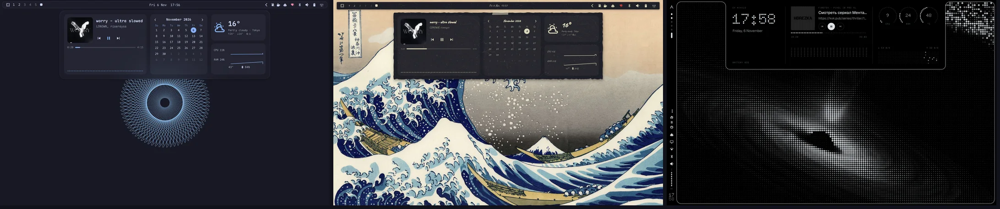
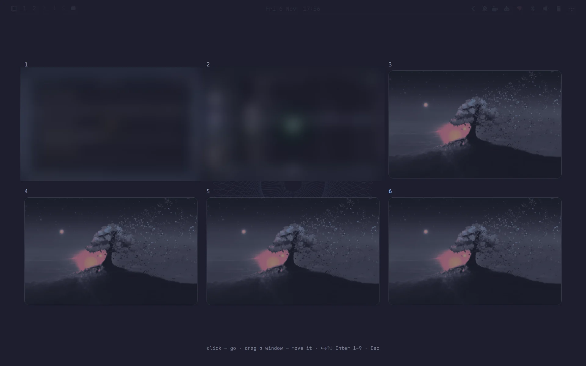
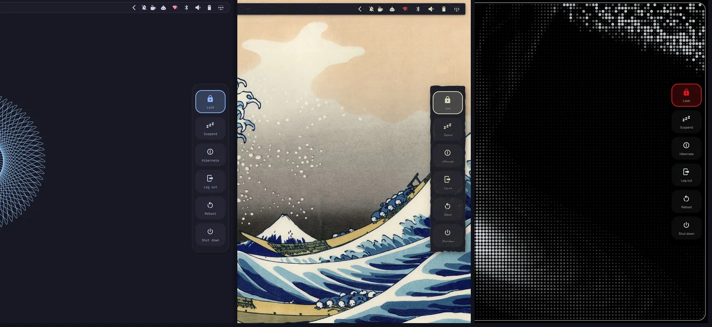

# Omarchy Desktop Widgets

[🇬🇧 English](README.md)

Виджеты рабочего стола, дашборд, меню выключения и обзор рабочих столов для [Omarchy](https://omarchy.org)
в стиле твоего бара. Один плагин типа `service`: cava, MPRIS и опрос `/proc` работают один раз на все мониторы.

| Часть | Что делает | Открыть |
|---|---|---|
| Виджеты | часы (5 стилей: … `vitreus` — цифры-трубки из стекла, часы над минутами с чертой, `clockVitreusLayout` rule / pipe / digital; + `dotmatrix` Doto), карточка «сейчас играет» (с LED-обложкой `DotScreen` в стиле `dotmatrix`), визуализатор cava (bars/mirror/wave + точки `dotmatrix`), кольца или 28-LED шкалы CPU/RAM/температуры/батареи (`sysinfoStyle: "vitreus"` — карточка-монитор Vitreus: хост и аптайм, три кольца CPU / память / видеокарта или температура, зеркальный график сети из 120 столбиков), график вкладов GitHub (`"contrib": true` + `"githubUser"`; публичному github-contributions-api.jogruber.de уходит только это имя; клик — профиль) — на слое Bottom, под окнами | всегда |
| Дашборд | `default` (плеер, календарь, погода, графики CPU/RAM) или `dotmatrix` (часы Doto, LED-обложка MPRIS, 24×6 спектр, 28-LED циферблаты CPU/RAM/°C, LED-осциллограф сети rx/tx) | `omarchy-shell widgets toggleDashboard` |
| Панель настроек | правая чёрная аппаратная панель DOT-MATRIX: 3×2 круглых тумблера (Wi-Fi, Bluetooth, звук, микрофон, DND, ночной свет), 24-сегментные LED-слайдеры, списки Wi-Fi/BT/аудио, история уведомлений и действия сессии с подтверждением | `omarchy-shell widgets toggleSettings` |
| Quick | при `"settingsPanel": "quick"` та же клавиша открывает Quick из [glyph-rice](https://github.com/Nebelung-cloud/glyph-rice): карточка справа внизу — часы, пилюли Wi-Fi / Bluetooth (правый клик — сети со строкой пароля / устройства для сопряжения), круглые плитки (не беспокоить, ночной свет, авиарежим, не засыпать, микрофон, запись экрана — правый клик: область / экран, звук системы / микрофона, камера — режим чтения, пипетка), слайдеры яркости и громкости из точек, профили питания (если есть power-profiles-daemon), мини-плеер и последние уведомления (replay; clear all — повторное нажатие за 3 с, история удаляется насовсем). Настройки записи — в `~/.config/omarchy/quick.json` | `omarchy-shell widgets toggleSettings` |
| Shot | скриншот из [glyph-rice](https://github.com/Nebelung-cloud/glyph-rice): экран замирает и гаснет, белая рамка 1 px с точками по углам и размером цифрами Doto, лупа из точек с цветом пикселя; режимы область / окно (Space) / экран / запись (Tab), таймер 3 / 13 с (T). Снимок — в `$OMARCHY_SCREENSHOT_DIR` или `~/Pictures/Screenshots` и в буфер; в углу выезжает карточка — клик открывает правку: перо, стрелка, рамка, пикселизация, текст, 4 цвета, 3 толщины, Ctrl+Z, Enter сохраняет и копирует. Запись — стоковой `omarchy-capture-screenrecording` с выбранной областью (звук и камера — из Quick) | `omarchy-shell widgets shot` · Print |
| Панели из бара | у стиля `liquid` (пресеты Vitreus) дашборд (`"dashAnimation": "liquid"`), панель настроек и меню выключения растут из своей кнопки бара — часов, звука / сети, питания (бар пишет `$XDG_RUNTIME_DIR/omarchy-bar-geom.json`, его читает `BarGeom.qml`) — у любого края. К бару во всю длину края (full, frame) панель прилипает вплотную, одним куском: у стекла — перешеек вдоль всей стороны с вогнутыми изгибами (`DrawerGeom.qml`), панель у кромки рамки прилипает и к ней («крылья»); у пластиковых основ (Retro, Doodle, …) на слитых сторонах нет контура, углы — вогнутые с контуром (`MergeFillet.qml`). У плавающей пилюли — зазор и узкий перешеек-капля . **Перенос панелей.** Дашборд, панель настроек и меню выключения отрывают от бара за верхнюю полосу или красный язычок основы Retro и носят по столу (`DrawerPull.qml`, `PullGrip.qml`): перешеек тянется и рвётся, отпущенная у своего места панель прилипает обратно, ближе 32 px к кромке рамки / бара — встаёт к ней вплотную и сливается. Место запоминается (`~/.config/omarchy/panel-places.json`) — следующее открытие сразу там; двойной клик по ручке возвращает панель к бару. **Дашборд Vitreus** (`"dashStyle": "vitreus"`, `DashGlass.qml`) — всё сразу, всплывает сквозь стекло: две высокие колбы-ползунки (громкость, яркость), часы градиентом акцента со шкалой дня рядом с напоминаниями (`omarchy-reminder`), последние уведомления с «Очистить» и «Не беспокоить», батарея с кнопкой питания, карточка пользователя (аватар — `"dashAvatar"`, задаётся в Customizer → Дашборд, иначе `~/.face`, иначе первая буква имени; хост, дистрибутив, ядро, аптайм), кольца CPU / памяти / GPU с сетью, погода с деталями и прогнозом на 7 дней, плеер с обложкой в кольце полос визуализатора и волной прогресса. Плитки всплывают по очереди, экран слегка темнеет. **surface** (`"dashStyle": "surface"`, `DashSurface.qml`, по мотивам [surface-dots](https://github.com/snes19xx/surface-dots), snes19xx — README разрешает брать со ссылкой, код свой): двухколоночный Hub его режима таскбара, 520 px под пилюлей часов (у нижнего бара — над ним): аватар и имя с кнопками монитора системы, Customizer, снимка и питания; плеер во всю ширину на размытой обложке с длинной волнистой полосой; большой календарь с погодой рядом со столбиком кнопок Wi-Fi / Bluetooth / профиль питания / уведомления и двумя высокими ползунками яркости и громкости; ближайшие напоминания (`omarchy reminder`); уведомления с Clear. Его компактный Hub — панель Super+M: `"settingsPanel": "surface"` (`SurfaceHub.qml`, его выбирает `auto` у райса surface): колонка 320 px с аватаром, аптаймом, снимком / записью / Customizer / питанием, восемью переключателями (Wi-Fi, Bluetooth, профиль питания, уведомления, ночной свет, микрофон, «не засыпать», режим чтения), ползунками яркости, громкости и микрофона, встроенными списками Wi-Fi / Bluetooth / выходов звука (правый клик по плитке или i / t / a), плеером, календарём и уведомлениями; клавиши d / l — тёмная / светлая тема surface, n — свернуть уведомления, s — Customizer. Общее состояние — `SurfState.qml`, карточка календаря — `SurfCalendar.qml`. Его меню выключения — `"powerStyle": "cassini"` (`PowerCassini.qml`, его выбирает `auto` у райса surface): карточка с засечками `@имя` / `up 2 hours` рядом со случайным снимком Сатурна миссии Cassini (NASA / JPL-Caltech / Space Science Institute, общественное достояние, `surface/cassini`), выбранная строка — зелёная плашка (у Reboot / Shutdown — красная), затем подтверждение No / Yes; стрелки, Enter, Esc. **Bruteon** (`"dashStyle": "bruteon"`, `DashBrute.qml`, по мотивам райса-необрутализма [Bruteon](https://github.com/Darkkal44/Bruteon) — облик с его скриншота, код свой): доска 820 px из кремовых карточек с толстым тёмным контуром и жёсткой тенью — профиль и столбик приложений, часы с датой, погода с цитатой по времени суток, ползунки громкости и яркости, плитки «System Specs», плеер с пастельной волной точек cava, полосы CPU / RAM / Disk и ряд пастельных плиток-ссылок. Его кнопка «Tasks» открывает `TasksBrute.qml` (`omarchy-shell widgets toggleTasks`): панель поверх окон под баром с задачами виджета Todo (добавить, отметить, правый клик — удалить) и рабочим помодоро (фокус 25 / 50, перерыв 5, длинный 15, уведомление в конце) или секундомером. Его стол: `"clockStyle": "bruteon"` — аналоговый циферблат с контуром и жёсткой тенью рядом с «Good morning, имя», крупное время с лавандовой плашкой AM / PM и дата; `"mediaStyle": "bruteon"` — обложка в плитке с контуром, название, исполнитель, волна точек cava, время и плитки назад / пауза (лососевая) / вперёд, видна и без плеера; виджет **погоды** (`"weather": true`, `WeatherWidget.qml`, город — `weatherCity`) — значок и крупная температура, «📍 город», описание и фишки влажности / ветра. Все берут цвета темы, так что и тёмная тема bruteon работает. **Меню Super+M райсов** (`MenuShell.qml` + `menus/Menu*.qml`, данные — `MenuData.qml`, списки разделов — `menus/SectionBody.qml`; `"settingsPanel"`, `auto` выбирает по райсу): **bruteon** — доска стикеров: пастельные плитки с контуром лежат чуть вразнобой, нажатая падает на свою тень, Wi-Fi / Bluetooth / Sound раскрываются большой карточкой, остальные разъезжаются; **yami** — пиксельный терминал: строки `> wifi`, `> night [x]` с буквами (w b a n d q), списки строками `[x]`, громкость блоками █▒; **cozytile** — полка язычков с S-образными боками (system · wi-fi · bluetooth · sound), активный вытягивает тёмную карточку, листается вбок, `[` `]` или колесо; **rumda** — карамельная капсула: боковая пилюля из кружков, выбранный раскрывает песочную карточку, толстые закруглённые столбики громкости и яркости; **glassring** (Vitreus) — стеклянные капли кольцом вокруг часов, колесо или `[` `]` крутят кольцо, выбранная капля перетекает в центр и становится стеклянной панелью; **instrument** (DOT-MATRIX) — приборная панель в духе Nothing: ручка-селектор (колесо или `[` `]`), точечный дисплей раздела, рычажки-тумблеры и красный LED. У всех: Wi-Fi с вводом пароля, устройства Bluetooth и поиск, выходы звука, громкость, микрофон, переключатели, блокировка / выключение, клавиатура через KeyNav. **Клавиатура** (`KeyNav.qml`): дашборд любого стиля и панели Super+M (выдвижная, Quick, Hub surface) управляются с клавиатуры — стрелки (и hjkl, где у панели нет своих букв) переходят к ближайшей кнопке в эту сторону, Tab / Shift+Tab — по порядку, Enter / Space — нажать, Esc — закрыть; выбор отмечает рамка цветом акцента с тонким контрастным ободком. Кнопки находятся сами (любая MouseArea / TapHandler), ползунок может добавить `kbdAdjust(шаг)` для ←/→. **Дашборд yami** (`"dashStyle": "yami"`, `DashYami.qml`): графитовые панели с рамкой в пиксель и жёсткой тенью 3 px, Tiny5 — крупные часы с двоеточием акцентом и шкалой дня из 16 штрихов, столбики истории cpu / mem и полосы disk / temp, квадратные ячейки-переключатели, плеер «♫ трек — исполнитель» с полосами акцентом, lock / sleep / reboot / power off. **Дашборд Cozytile** (`"dashStyle": "cozytile"`, `DashCozy.qml`): шапка из текущих обоев с крупными часами JetBrains Mono, тёмные карточки с язычками с S-образными боками, как у его бара, — погода, полосы системы, плеер, круглые переключатели, ползунки громкости и яркости и пять значков питания, всё цветом magenta темы. **Дашборд Glyph** (`"dashStyle": "glyph"`, `DashGlyph.qml`): чёрные карточки Nothing — огромные точечные часы Doto с мигающей красной точкой секунд, круговые шкалы CPU / MEM / DISK из точек, плеер с точечной обложкой и рядом точек прогресса, круглые переключатели и красная кнопка питания. Общие данные — `SysStats.qml` (cpu / mem / disk / temp и история). **Дашборд Unit-3** (`"dashStyle": "unit3"`, `DashNier.qml`, свой, в духе меню паузы NieR:Automata, облик Unit-3): бежевые листы NieR на доске 860 × 500 — шапка с вкладками STATUS / MEDIA / LOG / POWER (Super+M, плеер, история уведомлений, меню выключения), карточка юнита и PLUG-IN CHIPS (CPU / MEM / DISK / TEMP сегментными шкалами), крупные часы с японским днём недели, погода и INTEL (напоминания), MEDIA с обложкой в строках развёртки и LOG (последние уведомления); по доске бежит красная строка развёртки. **Плеер райса** (`PlayerHost.qml`, Super+Alt+M → `omarchy-shell widgets togglePlayer`): панель справа на 39 % высоты экрана с плеером MPRIS (играющим, иначе первым с треком), в облике райса — `players/Player<Вид>.qml` на общей основе `players/PlayerBase.qml` (`"playerStyle"`: `auto` — по райсу, либо вид по имени): unit3 (перенесён из Unit-3, MIT: обложка в строках развёртки, метки, ◀ PLAY ▶, уголки), bruteon (плитка с контуром и жёсткой тенью, пастельные кнопки), cozytile (тёмная карточка с язычком «now playing» с S-образными боками), rumda (песочная пилюля с крутящейся круглой обложкой и карамельными кнопками), surface (размытая обложка под вуалью, волнистая линия прогресса, пилюля кнопок; он же — без райса), yami (графитовая пиксельная панель Tiny5 с полосами акцентом), dotmatrix / glyph (точечная обложка, ряд точек прогресса, LED PLAYING), vitreus (жидкое стекло, круглая обложка в кольце полос визуализатора). **Шкала громкости NieR** (`NierVolume.qml`, райс Unit-3 или `"nierVolume": true`): 30 сегментов в рамке 40 × 420 у левого края, по мотивам его VolumeBar — выезжает при касании края курсором (полоса 3 px) и при каждом изменении громкости; клик / тяга — задать, колесо — ±8 %. **Unit-3** — `"settingsPanel": "unit3"` (`NierControl.qml`, перенесённый центр управления NieR из [Unit-3](https://github.com/samyns/Unit-3), MIT; `auto` выбирает его для райса Unit-3): Super+M открывает крест бежевых карточек NieR над затемнённым экраном — Connexion (Wi-Fi с вводом пароля на месте, Bluetooth со спариванием и поиском), Audio (выход, громкость), Quickshare (отправить / принять файлы с телефона по HTTP с QR-кодом, `unit3/qshare.py`, нужен `python-qrcode`; туннелю — `cloudflared`) и Notifications (история Omarchy и «не беспокоить»; «закрыть» только скрывает записи здесь — `~/.local/state/omarchy/unit3-dismissed.json`, файлы истории остаются). WASD / стрелки — ход, Enter — действие, Esc — назад; крест сдвигается, подводя открытую карточку к центру. Разделы с бара (`openSettingsSection wifi | bt | audio`) открывают свою карточку сразу. Меню выключения Cozytile — `"powerStyle": "cozytile"` (`PowerCozy.qml`, по мотивам его rofi-меню — только облик, код свой; его выбирает `auto` у райса Cozytile): карточка 800 px на текущих обоях с « Power» и аптаймом, пять крупных значков (блокировка, сон, выход, перезагрузка, выключение), выбранный — цветом выбора темы; выход, перезагрузка и выключение спрашивают «Are you sure?». **Rumda** (`"dashStyle": "rumda"`, `DashRumda.qml`, по мотивам hexonide/rumda — только облик): плотная карточка из блоков — аватар в двойном круге со столбиком кнопок питания, «Hello..» и имя с кнопками приложений и плеера, колонка яркости и график вкладов GitHub. **Карандаши** (`"dashStyle": "pencils"`, `DashVitreus.qml`): слева два ползунка-карандаша (громкость, яркость), справа плитки — часы и дата, погода, плеер (две клетки), переключатели (Wi-Fi, Bluetooth, микрофон, ночной свет), графики системы, зеркальный график сети, хост с аптаймом и батареей. Плитки всплывают по очереди, как из воды, по кромке у бара в это время бежит волна, экран слегка темнеет. **Виджеты yami**: `"clockStyle": "yami"` — крупное пиксельное время Tiny5 с жёсткой тенью и двоеточием цвета акцента, под ним дата и шкала дня из 16 штрихов; `"sysinfoStyle": "yami"` — три карточки (cpu, память, температура) со столбиками акцентом (`YamiSys.qml`); `"mediaStyle": "yami"` — широкая карточка «♫ silence — nothing playing» или трек, полосы визуализатора и линия прогресса акцентом, видна и без плеера; виджет **календаря** (`"calendar": true`, `CalWidget.qml`) — месяц с понедельника, сегодня акцентом, колесо листает месяцы; материал стиля `pixel` (`StyleCard`) — плоская графитовая панель с рамкой в пиксель и жёсткой тенью 3 px. **Украшения основ** (`BaseDecor.qml`) на этих панелях — по основе темы Vitreus: Retro — красный язычок, прорези-ручки и винт; Cyber — светящиеся уголки-скобки, линейка рисок и мигающий «терминальный» код; Paper — две полоски скотча на верхних углах; UwU — кошачьи уши, усы, мерцающие звёзды и покачивающиеся сердечки; Proxy — наклонная плита с полосой здоровья, плашка данных и полосатая направляющая; Doodle — второй контур от руки. Слитые с баром или рамкой стороны украшений не получают. Так же и карточки виджетов стола (`"edgeMerge": true`, по умолчанию): карточка с якорем у кромки бара / рамки или отпущенная ближе 32 px встаёт вплотную и сливается, а рамка на стыке разрывает свой контур (места стыков виджеты пишут бар-плагину в `$XDG_RUNTIME_DIR/omarchy-merge-widgets-<экран>.json`). | клавиша самой панели |
| Меню выключения | блокировка, сон, гибернация, выход, перезагрузка, выключение — три последних со второго нажатия за 3 с | `omarchy-shell widgets togglePower` |
| Меню выключения glyph · Clip | `"powerStyle": "glyph"` — меню выключения glyph-rice вместо полосы у края: почти чёрный экран, столбец слов Doto, выбранное крупно с красной точкой, кольцо аптайма из 60 точек; ↑↓ / j k, Enter. `"clipboardPanel": "glyph"` — Super+Ctrl+V открывает Clip из glyph-rice вместо стокового менеджера: история cliphist слева, запись целиком справа (текст, код, ссылка, образец цвета, картинка точками), фильтры все / текст / ссылки / картинки (Tab), Ctrl+P — закрепить, Del — удалить, Enter — скопировать | `togglePower` · `omarchy-shell widgets clip` |
| Prefs | быстрые настройки активного райса в виде Prefs из glyph-rice, своими шрифтами, скруглениями и акцентом райса (prefs/PTheme.qml): слева столбец слов Doto, справа раздел «предметом» — HOME (макет бенто 3 × 3, клик по плитке или чипу добавляет / убирает), DECK (экран с панелью у края, секции по порядку, кольцо задержки), BAR (части трея и заголовок окна раскладки `glyph-rice`), LOOK (точки / серое / цвет, кольца шага точек и яркости, glyph-dark / light, переключатель обоев), WINDOWS (кольца зазоров, рамки, скругления), IDLE (минуты до заставки и блокировки — в `idle` shell.json), SHELL (какие части из glyph: Super+M, меню выключения, буфер, picker обоев, лаунчер, лок). Пишет те же файлы, что Customizer, его бэкендом | `omarchy-shell widgets togglePrefs` · Super+Alt+I |
| Обзор | сетка рабочих столов с обоями и живыми превью окон; клик — перейти, перетащить окно — перенести. `"overviewStyle": "starmap"` (`OverviewStarmap.qml`, настоящее 3D на Qt Quick 3D, по мотивам звёздной карты [elifouts/Dotfiles](https://github.com/elifouts/Dotfiles), GPL-3.0 — его шейдер неба и миры) — два уровня со строкой «где ты»: **галактика** (твои столы — ядро с номерами и трассой, точки у звезды — её окна, «you are here»; за пунктирной границей UNCHARTED — пояс неизведанных систем, у каждой свой мир — одна из его девяти палитр и акцент, карточка показывает снимок пейзажа и палитру) и **система** (окна — 3D-планеты со снимком окна на наклонных орбитах; у неизведанной — планеты в цветах её мира). Два режима управления, F переключает (`"starmapNav"`): **route** — h/l по трассе (в поясе — по кольцу), k/j — в пояс и обратно, на звёздах, куда уведут клавиши, — стрелки ◂ ▸ ▴ ▾; **free** — полёт на WASD с инерцией, Q/E — вниз/вверх, Shift — быстрее, звезда в прицеле подсвечивается. Enter — войти в систему / сесть (на неизведанную — колонизировать: свободный стол получает её мир, `omarchy-space-world` из omarchy-rices), Esc — назад, 1–9 — сразу на стол, R — новая галактика; мышь: тянуть — вращать, колесо — зум, двойной клик — войти. В покое кадров не рисует; планеты вращаются только с `"starmapSpin": true`. `"overviewStyle": "voyage"` (по умолчанию у Space, `voyage/`) — его звёздная карта как есть: окна падают, земля обоев уходит в планету, дальше свободный полёт (мышь — взгляд, WASD / hjkl / стрелки — полёт, Shift — быстрее, Q/E — поворот, Tab — следующая система, Space — домой), Enter или клик — подлёт к тому, что в прицеле, или посадка, Esc — сесть обратно; планеты — пейзаж-шейдер своего мира, неизведанные системы вокруг занимают свободный стол и перекрашивают рабочий стол в свой мир (`omarchy-space-world`), как и посадка в систему другого мира. | `omarchy-shell widgets toggleOverview` |
| Режим правки | виджеты рабочего стола перетаскиваются куда угодно (сетка 8 px, прилипание к отступу от края); ПКМ — поверх окон, вернуть на место, скрыть; Esc / Enter — готово | `omarchy-shell widgets toggleEdit` |

**Стиль бара.** Дашборд и меню выключения следуют бару (`~/.config/omarchy/bar-skin.json` из
[omarchy-bar-skins](https://github.com/KamradSmeshnyavy/omarchy-bar-skins), без него — стоковые цвета):
со сплошным баром у края (`frame`, `hug`, `full`) они вырастают из-под него с вогнутыми углами; с прозрачным
или плавающим баром — плавающая карточка с отступом и тенью. У стеклянного бара — стеклянная панель
(с размытием, если оно включено в Hyprland). Всё можно задать вручную.

**Токены стиля.** `~/.config/omarchy/style.json` (пишет
[omarchy-customizer](https://github.com/KamradSmeshnyavy/omarchy-customizer) → Пресеты → Стиль) настраивает панели поверх
бара: `elevation` 0–2 (тени), `motion` (множитель скорости анимаций, 0 — без них), `material` (`auto` / `solid` /
`glass`), `cornerScale` (0 — прямые углы), `typeface` (`shell` — шрифт Omarchy, `profile` — sans из
`~/.config/omarchy/fonts.json`, `hand` — рукописный Caveat; иконки всегда в шрифте Omarchy). `material` `paper` / `soft` /
`brutal` / `bevel` / `glow` рисует плавающие панели через `StyleCard.qml`: лист бумаги (рваный край, тайл `texture`, скотч),
неоморфный рельеф, толстая рамка с жёсткой тенью, ретро-кант, неоновое свечение. Нет файла — вид как раньше.



| Обзор столов | Меню выключения |
| :---: | :---: |
|  |  |

<!-- Demo video: repo-videos/omarchy-desktop-widgets.mp4 — drag it here when editing this file on GitHub -->

## Установка

```sh
omarchy plugin add https://github.com/KamradSmeshnyavy/omarchy-desktop-widgets --enable
omarchy restart shell
```

Необязательно: `cava` (визуализатор). Клавиши и размытие для Hyprland (Lua-конфиг) — как в английском README.

## Требования

Omarchy 4 (Quattro) с его оболочкой. Проверено на Omarchy 4.0.6 и Quickshell 0.3.2.

- Необязательно: `cava` (визуализатор), `zenity` (правка заметки или цитаты), `brightnessctl` (яркость в быстрых настройках, есть в Omarchy).
- Необязательно: [Customizer](https://github.com/KamradSmeshnyavy/omarchy-customizer) — его стили (Flat, Glass, Fluent, DOT-MATRIX) пишут `~/.config/omarchy/style.json`, плагин их подхватывает; без него — значения по умолчанию.
- Дизайны DOT-MATRIX используют шрифты из [Customizer](https://github.com/KamradSmeshnyavy/omarchy-customizer) (Doto, Space Grotesk, Space Mono); без них — шрифт Omarchy.

## Удаление

```sh
omarchy plugin remove kamradsmeshnyavy.widgets
omarchy restart shell
```

Настройки остаются в `~/.config/omarchy/widgets.json`, `~/.config/omarchy/widgets-todo.json` — удалите их вручную, если не нужны.

## Настройки

`~/.config/omarchy/widgets.json`, применяются на лету (нет файла — значения по умолчанию).
[Customizer](https://github.com/KamradSmeshnyavy/omarchy-customizer) правит его в Рабочий стол → Виджеты / Дашборд.
Ключи и значения — в [README.md](README.md#settings).

**Части следуют райсу.** `homeLayout`, `homeCards`, `deckLayout`, `deckCards`, `settingsPanel`, `powerStyle` и `clipboardPanel` по умолчанию `auto` (встроенные стили тоже пишут `auto`): виджет сам выбирает вид по активному райсу — `"rice"` в `~/.config/omarchy/style.json`, его пишет вкладка Customizer **Райсы**, — а без райса по id стиля. У Glyph — свои дом, Deck, Quick, меню выключения и Clip; у DOT-MATRIX — дом и Deck glyph с панелью-шторкой; у Vitreus (и стиля `liquid`) — дом minimal, Deck во весь экран в материале основы и панели из бара; у остальных стилей — дом и Deck glyph в материале стиля. Явное значение важнее `auto`.

**Домашний экран** (раскладка `glyph` повторяет вид [glyph-rice](https://github.com/Nebelung-cloud/glyph-rice) — у него
GPL-3.0, поэтому код написан с нуля, а не скопирован): на пустом столе (на мониторе нет окон). Раскладки:
`glyph` — огромные точечные часы, «дата · неделя», приветствие в две строки и бенто из круглых и квадратных плиток;
`classic` — часы и плитки 3×3 в материале стиля; `minimal` — часы и приветствие в углу. Ключи: `"home": true`,
`"homeLayout"`, `"homeScale"`, `"homeWidgets"` (бенто glyph по порядку: `weather` `calendar` `cpu` `ram` `battery` `temp`
`disk` `cava` — одна клетка, `player` `network` — две, `system` — три; не влезшая в три ряда плитка не показывается),
`"homeCards"` (`glyph` — плоские карточки как в glyph-rice, `style` — материал стиля), `"homeGreeting"`, `"homeDate"`,
`"homeMeta"`, `"homeBlink"` (мигающее двоеточие), `"homeName"` (имя в приветствии, пусто — `$USER`), `"homeDots"`
(точечная сетка), `"homeHideWidgets"` (прятать виджеты на якорях, пока он виден; свободные и плавающие остаются).
Customizer → Рабочий стол → Виджеты → Домашний экран.

**Deck** (вид [glyph-rice](https://github.com/Nebelung-cloud/glyph-rice), код свой): курсор задержался на полосе 2 px у
нижнего края (150 мс) — выезжает дашборд: часы с точками светового дня, восходом и закатом, погода с прогнозом на 4 дня,
кольца CPU / памяти / температуры с процессами и матрицей CPU, сеть с матрицей приёма, плеер с точечной обложкой;
прячется через 300 мс, как курсор ушёл; над полноэкранными окнами не срабатывает. Ключи: `"deck": true`,
`"deckSections"` (по порядку: `clock` `weather` `perf` `net` `media`), `"deckCards"` (`glyph` · `style`), `"deckScale"`,
`"deckDelay"`, `"deckLayout"` (`panel` — секции в одной карточке, как в glyph-rice · `compact` — тонкая полоска: время,
три мини-кольца, трек с кнопкой, сеть · `full` — весь экран: затемнение `"deckDim"`, крупные часы и секции отдельными
карточками; закрывается кликом мимо или Esc), `"deckTrigger"` (`dwell` — задержаться у края · `bump` — толчок: коснуться
края, чуть отвести курсор и снова в край за 0,6 с; «давить» в край не отличить от «стоять» — Hyprland держит курсор у края
и событий движения не шлёт). IPC: `omarchy-shell widgets toggleDeck`. При включённом Deck нижняя зона `edgeHover` (лаунчер) выключена.
Customizer → Рабочий стол → Виджеты → Deck.

**Открепляемые виджеты** (идея из [Vitreus](https://github.com/natepayn3/Vitreus), код свой). Super+Ctrl+W
(`omarchy-shell widgets toggleEdit`) — режим правки: виджеты перетаскиваются мышью, ПКМ — «Поверх окон», «Вернуть
на место», «Скрыть». Перетащенный виджет получает `"<имя>Anchor": "free"` и `"<имя>Pos": { "cx", "cy", "screen" }` —
центр в долях экрана, так раскладка переживает смену разрешения; прежний якорь хранится в `<имя>AnchorDocked`.
`"<имя>Float": true` выносит свободный виджет на отдельный слой **поверх окон** (namespace `omarchy-widgets-float`,
создаётся, только пока такой виджет есть) — как плавающее окно. Кнопка-булавка на плеере дашборда
(`omarchy-shell widgets detach media`) отправляет карточку туда; `omarchy-shell widgets dock <имя>` возвращает. При наведении на плавающий виджет — две кнопки: «переместить» (режим правки) и «вернуть на место».
Имена: `clock` `media` `sysinfo` `network` `todo` `quote` `photo`. При `"desktopWidgets": false` виджеты на якорях
скрыты, но свободные и плавающие показываются, а режим правки показывает всё.

Правки QML — после `omarchy restart shell`. `BarStyle.qml` и `StyleCard.qml` общие с
[omarchy-edge-osd](https://github.com/KamradSmeshnyavy/omarchy-edge-osd) и
[omarchy-drawer-notifications](https://github.com/KamradSmeshnyavy/omarchy-drawer-notifications).

## Лицензия

GPL-3.0 (см. [LICENSE](LICENSE); прежние версии — MIT), авторы заимствований — в [NOTICE](NOTICE). Quick и Shot
(`QuickPanel.qml`, `glyph/`) — из [glyph-rice](https://github.com/Nebelung-cloud/glyph-rice) (GPL-3.0).
