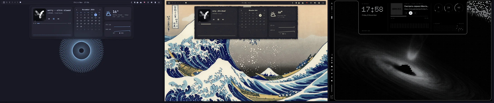
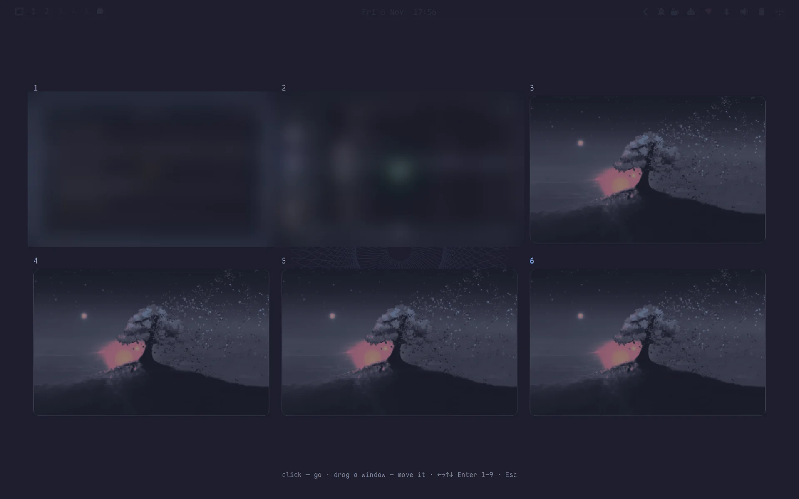
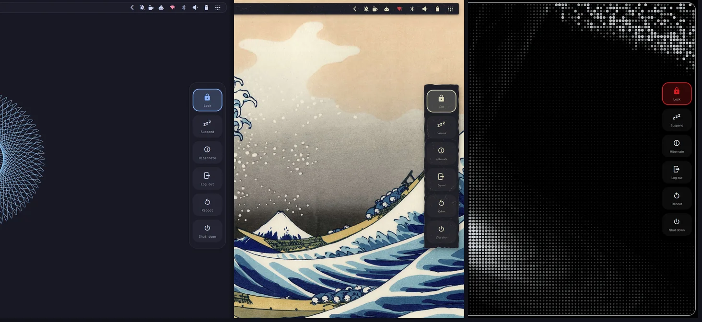

# Omarchy Desktop Widgets

[🇬🇧 English](README.md)

Виджеты рабочего стола, дашборд, меню выключения и обзор рабочих столов для [Omarchy](https://omarchy.org)
в стиле твоего бара. Один плагин типа `service`: cava, MPRIS и опрос `/proc` работают один раз на все мониторы.

| Часть | Что делает | Открыть |
|---|---|---|
| Виджеты | часы (4 стиля + `dotmatrix` Doto), карточка «сейчас играет» (с LED-обложкой `DotScreen` в стиле `dotmatrix`), визуализатор cava (bars/mirror/wave + точки `dotmatrix`), кольца или 28-LED шкалы CPU/RAM/температуры/батареи — на слое Bottom, под окнами | всегда |
| Дашборд | `default` (плеер, календарь, погода, графики CPU/RAM) или `dotmatrix` (часы Doto, LED-обложка MPRIS, 24×6 спектр, 28-LED циферблаты CPU/RAM/°C, LED-осциллограф сети rx/tx) | `omarchy-shell widgets toggleDashboard` |
| Панель настроек | правая чёрная аппаратная панель DOT-MATRIX: 3×2 круглых тумблера (Wi-Fi, Bluetooth, звук, микрофон, DND, ночной свет), 24-сегментные LED-слайдеры, списки Wi-Fi/BT/аудио, история уведомлений и действия сессии с подтверждением | `omarchy-shell widgets toggleSettings` |
| Меню выключения | блокировка, сон, гибернация, выход, перезагрузка, выключение — три последних со второго нажатия за 3 с | `omarchy-shell widgets togglePower` |
| Обзор | сетка рабочих столов с обоями и живыми превью окон; клик — перейти, перетащить окно — перенести | `omarchy-shell widgets toggleOverview` |
| Режим правки | виджеты рабочего стола перетаскиваются куда угодно (сетка 8 px, прилипание к отступу от края); ПКМ — поверх окон, вернуть на место, скрыть; Esc / Enter — готово | `omarchy-shell widgets toggleEdit` |

**Стиль бара.** Дашборд и меню выключения следуют бару (`~/.config/omarchy/bar-skin.json` из
[omarchy-bar-skins](https://github.com/KamradSmeshnyavy/omarchy-bar-skins), без него — стоковые цвета):
со сплошным баром у края (`frame`, `hug`, `full`) они вырастают из-под него с вогнутыми углами; с прозрачным
или плавающим баром — плавающая карточка с отступом и тенью. У стеклянного бара — стеклянная панель
(с размытием, если оно включено в Hyprland). Всё можно задать вручную.

**Токены стиля.** `~/.config/omarchy/style.json` (пишет
[omarchy-customizer](https://github.com/KamradSmeshnyavy/omarchy-customizer) → Пресеты → Стиль) настраивает панели поверх
бара: `elevation` 0–2 (тени), `motion` (множитель скорости анимаций, 0 — без них), `material` (`auto` / `solid` /
`glass`), `cornerScale` (0 — прямые углы), `typeface` (`shell` — шрифт Omarchy, `profile` — sans из
`~/.config/omarchy/fonts.json`, `hand` — рукописный Caveat; иконки всегда в шрифте Omarchy). `material` `paper` / `soft` /
`brutal` / `bevel` / `glow` рисует плавающие панели через `StyleCard.qml`: лист бумаги (рваный край, тайл `texture`, скотч),
неоморфный рельеф, толстая рамка с жёсткой тенью, ретро-кант, неоновое свечение. Нет файла — вид как раньше.



| Обзор столов | Меню выключения |
| :---: | :---: |
|  |  |

<!-- Demo video: repo-videos/omarchy-desktop-widgets.mp4 — drag it here when editing this file on GitHub -->

## Установка

```sh
omarchy plugin add https://github.com/KamradSmeshnyavy/omarchy-desktop-widgets --enable
omarchy restart shell
```

Необязательно: `cava` (визуализатор). Клавиши и размытие для Hyprland (Lua-конфиг) — как в английском README.

## Требования

Omarchy 4 (Quattro) с его оболочкой. Проверено на Omarchy 4.0.6 и Quickshell 0.3.2.

- Необязательно: `cava` (визуализатор), `zenity` (правка заметки или цитаты), `brightnessctl` (яркость в быстрых настройках, есть в Omarchy).
- Необязательно: [Customizer](https://github.com/KamradSmeshnyavy/omarchy-customizer) — его стили (Flat, Glass, Fluent, DOT-MATRIX) пишут `~/.config/omarchy/style.json`, плагин их подхватывает; без него — значения по умолчанию.
- Дизайны DOT-MATRIX используют шрифты из [Customizer](https://github.com/KamradSmeshnyavy/omarchy-customizer) (Doto, Space Grotesk, Space Mono); без них — шрифт Omarchy.

## Удаление

```sh
omarchy plugin remove kamradsmeshnyavy.widgets
omarchy restart shell
```

Настройки остаются в `~/.config/omarchy/widgets.json`, `~/.config/omarchy/widgets-todo.json` — удалите их вручную, если не нужны.

## Настройки

`~/.config/omarchy/widgets.json`, применяются на лету (нет файла — значения по умолчанию).
[Customizer](https://github.com/KamradSmeshnyavy/omarchy-customizer) правит его в Рабочий стол → Виджеты / Дашборд.
Ключи и значения — в [README.md](README.md#settings).

**Домашний экран** (раскладка `glyph` повторяет вид [glyph-rice](https://github.com/Nebelung-cloud/glyph-rice) — у него
GPL-3.0, поэтому код написан с нуля, а не скопирован): на пустом столе (на мониторе нет окон). Раскладки:
`glyph` — огромные точечные часы, «дата · неделя», приветствие в две строки и бенто из круглых и квадратных плиток;
`classic` — часы и плитки 3×3 в материале стиля; `minimal` — часы и приветствие в углу. Ключи: `"home": true`,
`"homeLayout"`, `"homeScale"`, `"homeWidgets"` (бенто glyph по порядку: `weather` `calendar` `cpu` `ram` `battery` `temp`
`disk` `cava` — одна клетка, `player` `network` — две, `system` — три; не влезшая в три ряда плитка не показывается),
`"homeCards"` (`glyph` — плоские карточки как в glyph-rice, `style` — материал стиля), `"homeGreeting"`, `"homeDate"`,
`"homeMeta"`, `"homeBlink"` (мигающее двоеточие), `"homeName"` (имя в приветствии, пусто — `$USER`), `"homeDots"`
(точечная сетка), `"homeHideWidgets"` (прятать виджеты на якорях, пока он виден; свободные и плавающие остаются).
Customizer → Рабочий стол → Виджеты → Домашний экран.

**Deck** (вид [glyph-rice](https://github.com/Nebelung-cloud/glyph-rice), код свой): курсор задержался на полосе 2 px у
нижнего края (150 мс) — выезжает дашборд: часы с точками светового дня, восходом и закатом, погода с прогнозом на 4 дня,
кольца CPU / памяти / температуры с процессами и матрицей CPU, сеть с матрицей приёма, плеер с точечной обложкой;
прячется через 300 мс, как курсор ушёл; над полноэкранными окнами не срабатывает. Ключи: `"deck": true`,
`"deckSections"` (по порядку: `clock` `weather` `perf` `net` `media`), `"deckCards"` (`glyph` · `style`), `"deckScale"`,
`"deckDelay"`, `"deckLayout"` (`panel` — секции в одной карточке, как в glyph-rice · `compact` — тонкая полоска: время,
три мини-кольца, трек с кнопкой, сеть · `full` — весь экран: затемнение `"deckDim"`, крупные часы и секции отдельными
карточками; закрывается кликом мимо или Esc), `"deckTrigger"` (`dwell` — задержаться у края · `bump` — толчок: коснуться
края, чуть отвести курсор и снова в край за 0,6 с; «давить» в край не отличить от «стоять» — Hyprland держит курсор у края
и событий движения не шлёт). IPC: `omarchy-shell widgets toggleDeck`. При включённом Deck нижняя зона `edgeHover` (лаунчер) выключена.
Customizer → Рабочий стол → Виджеты → Deck.

**Открепляемые виджеты** (идея из [Vitreus](https://github.com/natepayn3/Vitreus), код свой). Super+Ctrl+W
(`omarchy-shell widgets toggleEdit`) — режим правки: виджеты перетаскиваются мышью, ПКМ — «Поверх окон», «Вернуть
на место», «Скрыть». Перетащенный виджет получает `"<имя>Anchor": "free"` и `"<имя>Pos": { "cx", "cy", "screen" }` —
центр в долях экрана, так раскладка переживает смену разрешения; прежний якорь хранится в `<имя>AnchorDocked`.
`"<имя>Float": true` выносит свободный виджет на отдельный слой **поверх окон** (namespace `omarchy-widgets-float`,
создаётся, только пока такой виджет есть) — как плавающее окно. Кнопка-булавка на плеере дашборда
(`omarchy-shell widgets detach media`) отправляет карточку туда; `omarchy-shell widgets dock <имя>` возвращает. При наведении на плавающий виджет — две кнопки: «переместить» (режим правки) и «вернуть на место».
Имена: `clock` `media` `sysinfo` `network` `todo` `quote` `photo`. При `"desktopWidgets": false` виджеты на якорях
скрыты, но свободные и плавающие показываются, а режим правки показывает всё.

Правки QML — после `omarchy restart shell`. `BarStyle.qml` и `StyleCard.qml` общие с
[omarchy-edge-osd](https://github.com/KamradSmeshnyavy/omarchy-edge-osd) и
[omarchy-drawer-notifications](https://github.com/KamradSmeshnyavy/omarchy-drawer-notifications).

## Лицензия

MIT
